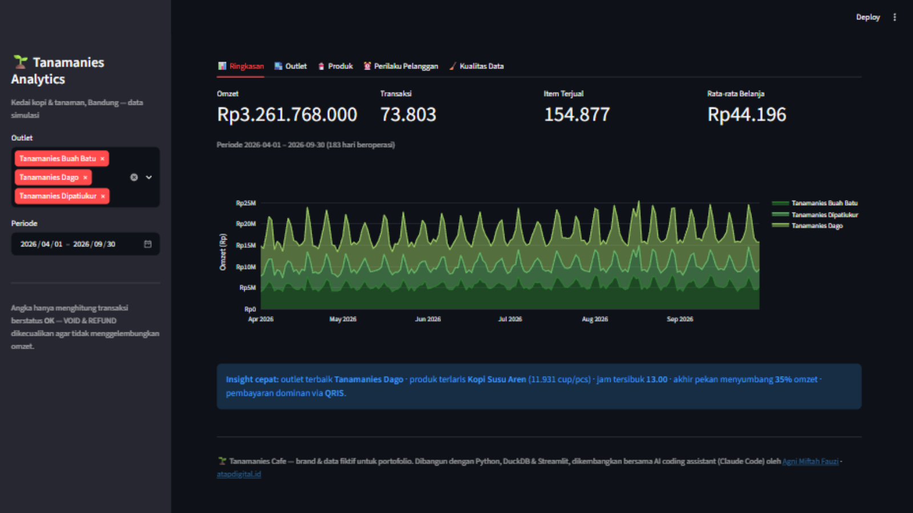
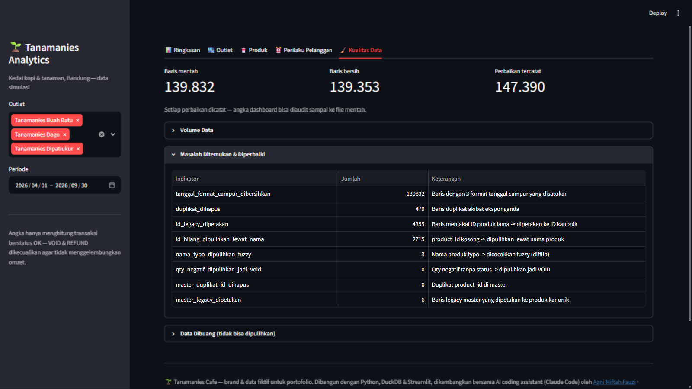

# 🌱 Tanamanies Cafe Analytics

**Simulasi end-to-end sistem data & AI untuk bisnis F&B multi-outlet** — dari ekspor POS mentah yang kotor sampai dashboard performa harian dan AI assistant yang bisa menjawab pertanyaan bisnis.

> Tanamanies Cafe adalah **brand fiktif** kedai kopi di Bandung yang dipenuhi tanaman.
> Seluruh data pada project ini adalah **data simulasi yang di-generate**, bukan data bisnis nyata.
> Project ini dibuat sebagai portofolio *data pipeline + analytics + AI integration*.

**🔗 Demo live:** [tanamanies-cafe-analytics.streamlit.app](https://tanamanies-cafe-analytics.streamlit.app) — di-deploy di Streamlit Community Cloud; data dibangun otomatis oleh aplikasi saat pertama dijalankan di cloud.



## Kenapa project ini ada

Masalah nyata di bisnis F&B multi-outlet: setiap outlet punya POS berbeda, ekspor datanya kotor
(tanggal campur format, nama produk tidak konsisten, ID lama, duplikat), dan manajemen tidak punya
satu sumber angka yang bisa dipercaya. Project ini mendemonstrasikan solusinya secara lengkap:

```
Ekspor POS mentah (18 file CSV, 139.832 baris, sengaja kotor)
        │
        ▼
Pipeline pembersihan Python (pandas) ──► Laporan Kualitas Data (audit trail)
        │
        ▼
Database analitik DuckDB (fact & dim + 6 view SQL)
        │
        ├──► Dashboard performa (Streamlit + Plotly) — untuk manajemen
        └──► MCP server — agar AI assistant (Claude Code) bisa query data untuk tiap divisi
```

## Kegunaan / apa yang didemonstrasikan

| Kemampuan | Wujudnya di project ini |
|---|---|
| **Data pipeline harian** | Generator meniru ekspor POS harian; `run_all` menjalankan clean → load → report satu perintah |
| **Data cleansing lintas sumber** | 3 format tanggal campur, 16+ sebutan metode bayar, nama outlet tidak konsisten, duplikat ekspor, qty negatif tanpa status |
| **Resolusi master data** | Master produk kotor (ID legacy, nama beda kapital, typo) disatukan: exact match → fuzzy matching (difflib, cutoff 0.8) |
| **SQL & arsitektur database** | DuckDB: tabel `fact_sales` + `dim_product` + `dim_outlet`, 6 view analitik dengan JOIN & agregasi (`sql/views.sql`) |
| **Dashboard dengan angka akurat** | KPI + tren omzet, perbandingan outlet, produk terlaris, heatmap jam ramai, komposisi pembayaran — VOID/REFUND dikecualikan dari omzet |
| **Kualitas data yang bisa diaudit** | Setiap perbaikan dicatat: 479 duplikat dihapus, 4.355 ID legacy dipetakan, 2.715 ID hilang dipulihkan lewat nama → [docs/laporan_kualitas_data.md](docs/laporan_kualitas_data.md) |
| **Akses data via AI (MCP)** | [src/mcp_server.py](src/mcp_server.py) menyediakan tool `ringkasan_periode`, `top_produk`, `penjualan_harian`, `jalankan_sql` (read-only) untuk Claude Code |
| **Testing** | 42 unit test pytest untuk semua aturan cleansing (`tests/`) |



## Cara menjalankan

Butuh Python 3.11+.

```bash
# 1. Siapkan environment
py -3.13 -m venv .venv
.venv\Scripts\pip install -r requirements.txt      # Windows
# source .venv/bin/activate && pip install -r requirements.txt  # Linux/Mac

# 2. Jalankan seluruh pipeline (generate data + bersihkan + bangun DB + laporan)
.venv\Scripts\python -m src.run_all --with-data

# 3. Buka dashboard
.venv\Scripts\python -m streamlit run dashboard/app.py

# 4. (Opsional) Jalankan test
.venv\Scripts\python -m pytest -q
```

Perintah `run_all --with-data` menghasilkan 18 file ekspor POS simulasi (Apr–Sep 2026, 3 outlet,
±140 ribu baris) lalu membersihkannya. Seed RNG dikunci, jadi angka selalu sama — penting untuk
reproduksibilitas.

### Hubungkan AI assistant (MCP)

Buat file `.mcp.json` di root project:

```json
{
  "mcpServers": {
    "tanamanies-analytics": {
      "command": ".venv/Scripts/python.exe",
      "args": ["-m", "src.mcp_server"]
    }
  }
}
```

Lalu di Claude Code cukup tanya: *"Bandingkan omzet 3 outlet bulan Agustus, lalu produk apa yang
paling menopang Dago?"* — assistant memanggil tool yang tersedia dan menjawab dari database yang
sudah dibersihkan. Keamanan: database dibuka **read-only**, `jalankan_sql` hanya menerima
`SELECT`/`WITH`, hasil dibatasi 200 baris.

### Contoh query SQL manual

Lihat [sql/queries_contoh.sql](sql/queries_contoh.sql) — omzet harian, perbandingan outlet,
produk terlaris, pertumbuhan bulanan.

### Deploy ke cloud (Streamlit Community Cloud — gratis)

Dashboard ini tidak bisa di Vercel (butuh server Python aktif, bukan static site).
Cara termudah: [Streamlit Community Cloud](https://share.streamlit.io), gratis dan langsung dari GitHub:

1. Buka [share.streamlit.io](https://share.streamlit.io) → login dengan akun GitHub.
2. Klik **New app** → pilih repo **`tanamanies-cafe-analytics`**, branch `main`,
   main file path **`dashboard/app.py`** → **Deploy**.
3. Selesai — dapat URL publik seperti `https://tanamanies-analytics.streamlit.app`.

Saat pertama dibuka di cloud, aplikasi otomatis membangun data simulasi sendiri
(±1–2 menit, sekali saja — hasil identik dengan lokal karena seed RNG dikunci).
Di lokal yang sudah punya `data/tanamanies.duckdb`, auto-bootstrap ini tidak pernah dijalankan.

> Catatan: MCP server tidak ikut di-deploy — ia berjalan lokal, terhubung ke AI assistant
> di mesin yang sama dengan database-nya.

## Struktur repo

```
├── src/
│   ├── config.py             # path, periode, definisi 3 outlet
│   ├── generate_pos_data.py  # generator POS simulasi (data kotor terkontrol, seed 42)
│   ├── clean_pipeline.py     # cleansing: tanggal, outlet, harga, qty, dedupe, resolusi produk
│   ├── build_db.py           # DuckDB: tabel + view SQL
│   ├── quality_report.py     # laporan kualitas data (markdown, audit trail)
│   ├── run_all.py            # orkestrator satu perintah
│   └── mcp_server.py         # MCP server (akses data via AI, read-only)
├── dashboard/app.py          # Streamlit: 5 tab analitik
├── sql/views.sql             # definisi 6 view analitik (satu sumber metrik)
├── tests/test_cleaning.py    # 42 unit test aturan cleansing
├── data/sample/              # contoh file mentah + master kotor (untuk inspeksi)
└── docs/                     # laporan kualitas data, panduan presentasi, screenshot
```

## Keputusan desain yang penting

- **VOID & REFUND tetap disimpan** di `fact_sales` dengan kolom `status`, tapi dikecualikan dari
  semua perhitungan pendapatan. Datanya tetap berguna untuk analisis tren pembatalan, tanpa
  menggelembungkan omzet.
- **Data tidak bisa dipulihkan dibuang dan dicatat**, bukan ditebak diam-diam. Semua keputusan
  tercatat di laporan kualitas data.
- **Metrik didefinisikan sekali** di `sql/views.sql` — dashboard, MCP, dan query manual dijamin
  memakai definisi angka yang sama.
- **Data mentah & database tidak di-commit** (`.gitignore`) — yang di-commit adalah kode, sample,
  dan laporan. Cara kerja yang sama seperti data produksi yang sifatnya rahasia.

## Screenshot lain

Tab **Kualitas Data** (gambar di atas) menampilkan audit trail lengkap: berapa baris masuk, berapa
yang diperbaiki dan dengan cara apa, serta berapa yang dibuang.

---

Dibuat oleh [Agni Miftah Fauzi](https://github.com/Atazyyy) — AI Specialist / AI Systems.
Dikembangkan bersama AI coding assistant (Claude Code). Portfolio: [atapdigital.id](https://atapdigital.id)
